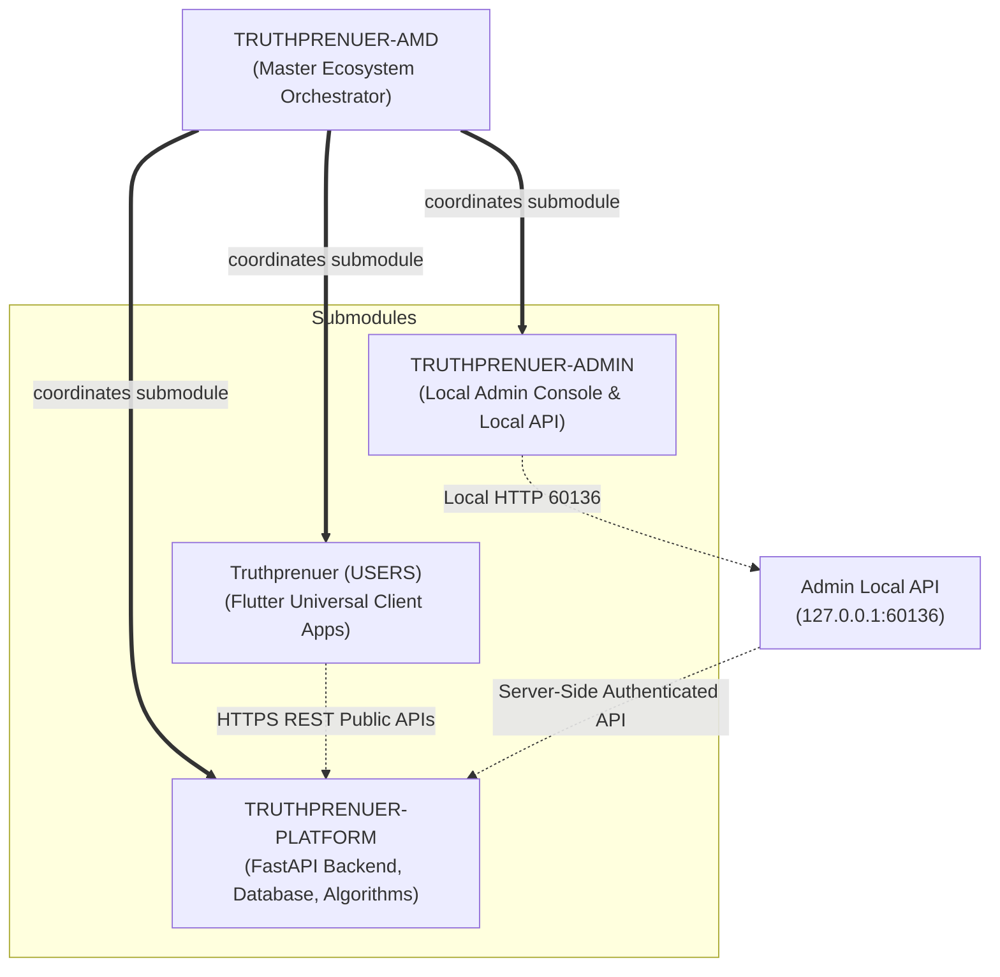

# Truthprenuer Ecosystem Architecture Specification

## 1. Architectural Philosophy
Truthprenuer is structured as a professional, multi-repository distributed system rather than a monorepo. This guarantees:
- **Independent Release Cycles:** Mobile apps (App Store / Play Store) can release asynchronously from server backend deployments.
- **Access Boundary Enforcement:** Admin console code, privileged endpoints, and security tooling cannot leak into consumer client bundles.
- **Repository Specialization:** Python data science & algorithms, TypeScript web applications, and Dart Flutter code maintain clean dependency isolation without toolchain interference.

---

## 2. Multi-Repository Topology

---

## 3. Communication Model & Security Contracts

1. **User Client to Platform:**
   - Flutter client invokes public endpoints: `/api/v1/health`, `/api/v1/ai/validate`, `/api/v1/pitches`.
   - Requires Supabase User JWT bearer token.
   - Enforces rate limiting (60 requests/minute per IP).
2. **Admin Client to Local API:**
   - React Admin console binds strictly to `http://127.0.0.1:60135`.
   - Local Privileged API binds strictly to `http://127.0.0.1:60136`.
   - Zero-trust local origin check verifies `Origin: http://127.0.0.1:60135`.
   - Rejects non-loopback IPs and spoofed headers.
3. **Local API to Platform:**
   - Communicates server-to-server using TLS and service-role credentials.
   - Operates behind secure VPC or authenticated server endpoints.
